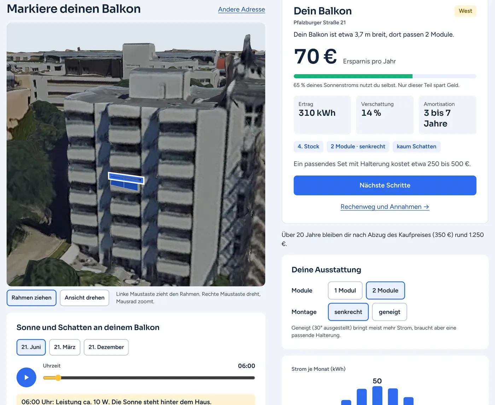
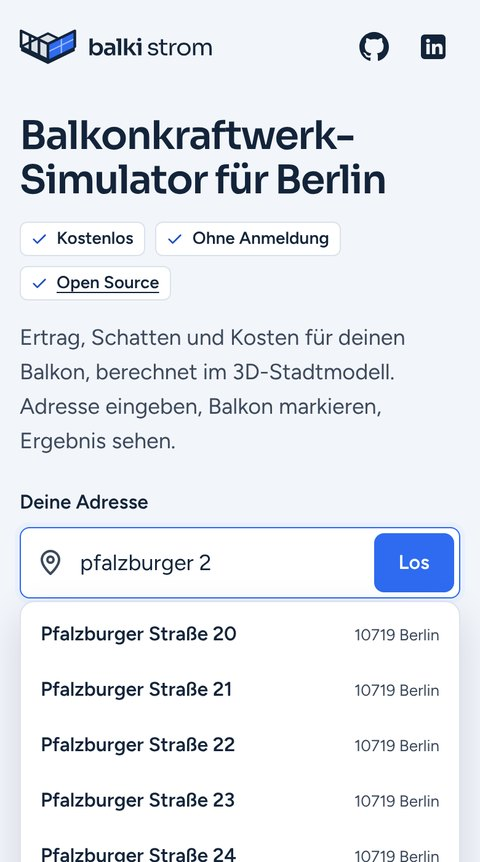
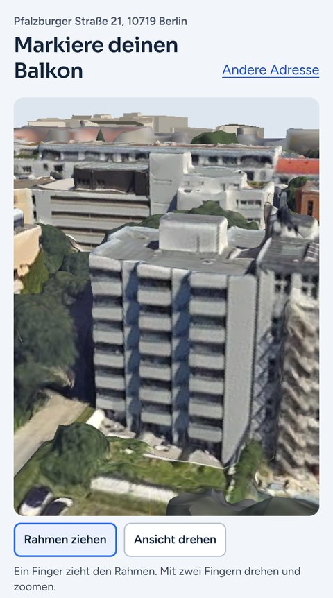
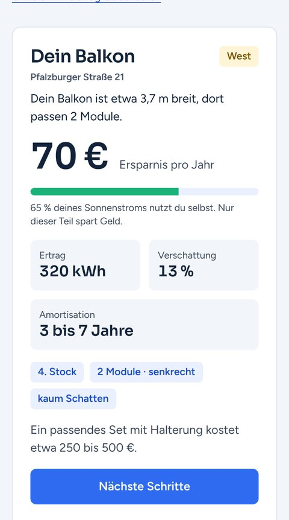

<p align="center">
  <picture>
    <source media="(prefers-color-scheme: dark)" srcset="web/bilder/logo-dunkel.svg">
    
  </picture>
</p>

<p align="center">
  <b>Balkonkraftwerk-Simulator für Berlin</b><br>
  Adresse eingeben, das eigene Haus im 3D-Stadtmodell von Berlin sehen, den Balkon markieren.<br>
  Ertrag, Schatten übers ganze Jahr, Ersparnis und die nächsten Schritte.
</p>

<p align="center">
  <a href="LICENSE"></a>
  <a href="#datenschutz"></a>
  <a href="#datenschutz"></a>
  <a href="requirements-server.txt"></a>
</p>

<p align="center"><sub><i>Balcony solar simulator for Berlin. Free, open source, no sign-up.</i></sub></p>

<p align="center">
  
</p>
<p align="center"><sub>Echte Oberfläche, echtes 3D-Mesh von Berlin: Balkon markiert, Sonnenverlauf am 21. Juni mit der Leistung zu jeder Uhrzeit.</sub></p>

---

## So funktioniert's

<table>
  <tr>
    <th width="33%">1 · Adresse eingeben</th>
    <th width="33%">2 · Balkon markieren</th>
    <th width="33%">3 · Ergebnis und Schritte</th>
  </tr>
  <tr>
    <td valign="top"></td>
    <td valign="top"></td>
    <td valign="top"></td>
  </tr>
  <tr>
    <td valign="top"><sub>Die Suche läuft nur im Browser, auf den amtlichen Hauskoordinaten. Tippfehler, „str.“ und fehlende Umlaute sind kein Problem.</sub></td>
    <td valign="top"><sub>Das Haus erscheint im fototexturierten 3D-Mesh. Ein Rahmen über die Breite des Balkons legt fest, wo und wie viele Module hängen.</sub></td>
    <td valign="top"><sub>Ersparnis, Ertrag, Schatten und Amortisation. Danach: Zustimmung einholen, Set kaufen, montieren, im Marktstammdatenregister anmelden.</sub></td>
  </tr>
</table>

## Warum

Balkonkraftwerke sind günstig, legal und schnell montiert. Trotzdem haben die meisten Haushalte mit Balkon keins. Selten liegt es an der Technik, meist am Weg dorthin: Wer sich nicht für Solar interessiert, recherchiert weder Wattzahlen noch Ausrichtung oder Halterungen. balki strom rechnet für den eigenen Balkon vor und zeigt, wie wenig danach noch zu tun ist.

Das Projekt soll Initiativen wie die [Balkonkraftwerk-Aktion des Bezirks Friedrichshain-Kreuzberg](https://www.berlin.de/ba-friedrichshain-kreuzberg/politik-und-verwaltung/service-und-organisationseinheiten/klima-und-internationales/balkonkraftwerke-f-r-mieter-innen-1731789.php) unterstützen. Es ist unabhängig und kein offizielles Angebot des Bezirks.

## Funktionen

- **Eigenes Haus in 3D:** Berliner 3D-Mesh mit Fototextur; lädt nur die Umgebung der Adresse (erste Ansicht ≈ 1,5 MB) und läuft auch auf schwachen Geräten.
- **Schatten übers ganze Jahr:** Nachbarhäuser und Bäume im Umkreis von 220 m, Stunde für Stunde, Bäume im Sommer dichter als im Winter.
- **Ehrliche Wirtschaftlichkeit:** Nur selbst verbrauchter Strom spart Geld; Eigenverbrauch aus einem minutengenauen Haushaltsmodell. Strompreis, Haushalt und „tagsüber zu Hause“ sind änderbar.
- **Nächste Schritte:** Zustimmung von Vermieter\*in (fertige E-Mail, § 554 BGB) oder Eigentümergemeinschaft (§ 20 WEG), Checkliste fürs Set, Montage, Anmeldung im Marktstammdatenregister.
- **Datensparsam:** keine Anmeldung, keine Cookies, kein Tracking, keine externen Ressourcen, nichts gespeichert.

## Schnellstart

Voraussetzungen: Python 3.10+, eine Mesh-Kachel aus dem [Berlin 3D-Downloadportal](https://www.businesslocationcenter.de/berlin3d-downloadportal/).

```bash
git clone https://github.com/janhh011/balki_strom.git && cd balki_strom
python3 -m venv .venv && source .venv/bin/activate
pip install -r requirements.txt

python3 pipeline/kachel.py data/3858_58171_-002 --name Wilmersdorf   # Kachel -> Web-Paket + Server-Cache
python3 pipeline/adressen.py                                          # amtliche Hauskoordinaten
python3 server/app.py                                                 # http://127.0.0.1:8000
```

`kachel.py` lädt die offenen Daten für die Umgebung (LoD2, bDOM, ≈ 100 MB) selbst von gdi.berlin.de. Weitere Kachel: denselben Befehl mit einem anderen Ordner ausführen, `adressen.py` erneut, Server neu starten. Nachbarkacheln aktualisieren sich automatisch.

Tests: `python3 tests/test_rechner.py`

<details>
<summary><b>Was wird gerechnet?</b></summary>

| Schritt | Wo | Wie |
|---|---|---|
| Wand und Modullage | Server, `balki/rechner.py` | Wandrichtung aus den Mesh-Dreiecken um den Tipp-Punkt, Außenseite und Geländerkante aus dem Mesh; Module hängen außen vor dem Geländer. |
| Horizont | Server, `balki/physik.py` | Punktwolke im Umkreis von 220 m (Mesh; außerhalb der Kachel LoD2-Gebäude und bDOM-Bäume), 2°-Sektoren, Gebäude und Bäume getrennt. |
| Ertrag | Server, `balki/physik.py` | Stündliche Jahressimulation mit [pvlib](https://pvlib-python.readthedocs.io) (Erbs, Hay-Davies, ASHRAE-IAM, Faiman, PVWatts). 430-Wp-Module, Wechselrichter 800 W. Baumkronen lassen 30 % (Mai bis Oktober) bzw. 65 % (November bis April) des Lichts durch. |
| Wirtschaftlichkeit | Browser, `web/js/` | 8 760 Stundenwerte gegen einen minutengenauen Haushaltslastgang → Eigenverbrauch, € pro Jahr, Amortisation über 20 Jahre. Annahmen in [`params.js`](web/js/params.js). |

**Grenzen:** Wetter ist ein synthetisches Berliner Referenzjahr (PVGIS ist vorbereitet, siehe [Backlog](docs/BACKLOG.md)). Die Rechnung ist noch nicht mit gemessenen Erträgen geprüft; sie ist eine Schätzung, keine Zusage. Derzeit eine Kachel in Berlin-Wilmersdorf; Kreuzberg folgt, sobald das Downloadportal wieder läuft. Preise: Richtwerte November 2026.
</details>

<details>
<summary><b>Architektur, API und Projektstruktur</b></summary>

```
Browser ── statisch: index.html, js/, tiles/ (Zellen, Texturstufen), adressen.json
        └─ POST /api/ertrag ──▶ server/app.py ──▶ balki/rechner.py + physik.py (Punktwolke je Kachel)
```

```http
POST /api/ertrag
Content-Type: application/json

{"kachel": "3858_58171", "x": 386001.2, "y": 5817300.4, "z": 52.3, "nx": 0.02, "ny": -0.99,
 "module": 2, "aufstellung": "senkrecht"}
```

Antwort: Himmelsrichtung, Geschoss, Modulecken, `kwh_jahr` (mit Schatten) und `kwh_jahr_frei`, Monats- und 8 760 Stundenwerte, Horizont, Hinweise. Fehler: `400` mit Text, `429` Ratenlimit, `503` ausgelastet. Koordinaten in EPSG:25833.

```
balki/          physik.py (Wetter, Horizont, Ertrag), rechner.py (Tipp-Punkt -> Module -> Ertrag)
pipeline/       kachel.py (Mesh-Kachel -> Web-Paket + Server-Cache), adressen.py
server/app.py   Webserver: statische Dateien + POST /api/ertrag
web/            index.html, css/, fonts/, bilder/, vendor/three/, js/
tests/          synthetische Testszene
docs/           Architektur, Betrieb, Bereitstellung, Backlog, Styleguide
```

| Dokument | Inhalt |
|---|---|
| [ARCHITEKTUR.md](docs/ARCHITEKTUR.md) | Ablauf, Verzeichnisse, Schnittstellen |
| [BETRIEB.md](docs/BETRIEB.md) | Server einrichten: Caddy, systemd, Grenzen |
| [BEREITSTELLUNG.md](docs/BEREITSTELLUNG.md) | Checkliste Recht, Datenschutz, Barrierefreiheit |
| [BACKLOG.md](docs/BACKLOG.md) | Offene Punkte und Ideen |
| [STYLEGUIDE.md](docs/STYLEGUIDE.md) | Farben, Schrift, Logo |

Ältere Skripte in `pipeline/` (LoD2-Fassaden, automatische Balkonerkennung) stammen aus einer früheren Version und werden von der Seite nicht verwendet.
</details>

## Daten und Lizenzen

| Quelle | Verwendung | Lizenz |
|---|---|---|
| 3D-Stadtmodell (Mesh), © Senatsverwaltung für Stadtentwicklung, Bauen und Wohnen Berlin, Berlin 3D-Downloadportal | Hausansicht, Schatten | nicht kommerzielle Nutzung; Rohdaten und Kacheln sind **nicht** im Repository |
| Geoportal Berlin: LoD2-Gebäude, bDOM, amtliche Hauskoordinaten | Schatten außerhalb der Kachel, Geländehöhe, Adresssuche | Datenlizenz Deutschland Zero, Version 2.0 |
| [three.js](https://threejs.org) · [pvlib](https://github.com/pvlib/pvlib-python) · Sora, Figtree | 3D-Ansicht · Ertragsrechnung · Schriften | MIT · BSD-3-Clause · OFL 1.1 |

Der Code steht unter der [GNU AGPL-3.0](LICENSE): frei nutzbar und veränderbar; wer eine geänderte Fassung als Website betreibt, legt deren Quellcode offen.

## Datenschutz

Die Adresssuche läuft im Browser. Der Server erhält nur die Koordinaten des markierten Balkons und die gewählte Ausstattung, keine Adresse und keinen Namen. Keine Cookies, kein Speicher im Browser, kein Tracking, keine Anfragen an Dritte, keine Zugriffsprotokolle. Die E-Mail an die Vermieterseite entsteht im Browser. Details: [Datenschutzerklärung](web/datenschutz.html).

## Mitmachen

Fehlerberichte, Ideen und Pull Requests sind willkommen, besonders gemessene Jahreserträge echter Balkonkraftwerke in Berlin, um die Rechnung zu prüfen. Siehe [CONTRIBUTING.md](CONTRIBUTING.md); Sicherheitslücken bitte vertraulich nach [SECURITY.md](SECURITY.md).

---

<p align="center">
  <sub>Jan-Hendrik Höltkemeier · M.Sc., TU Berlin · <a href="https://github.com/janhh011">GitHub</a> · <a href="https://www.linkedin.com/in/jan-hendrik-h%C3%B6ltkemeier/">LinkedIn</a></sub>
</p>
