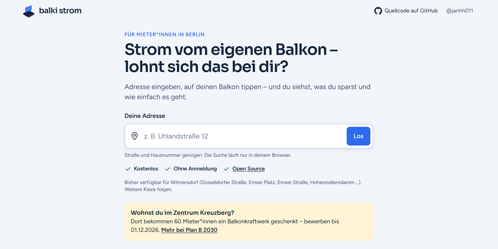
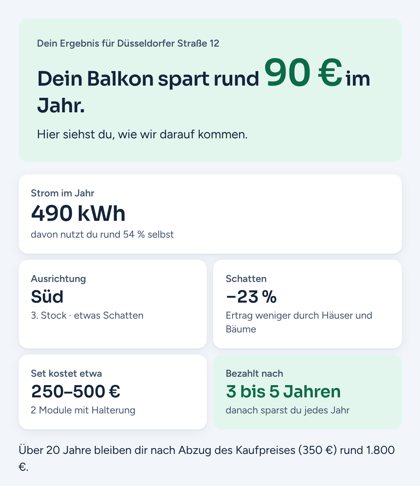
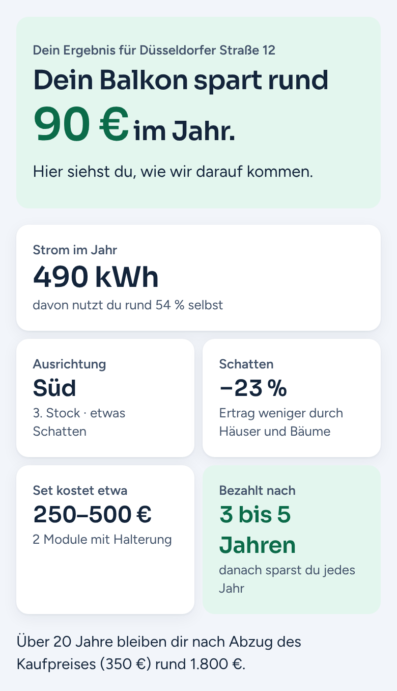
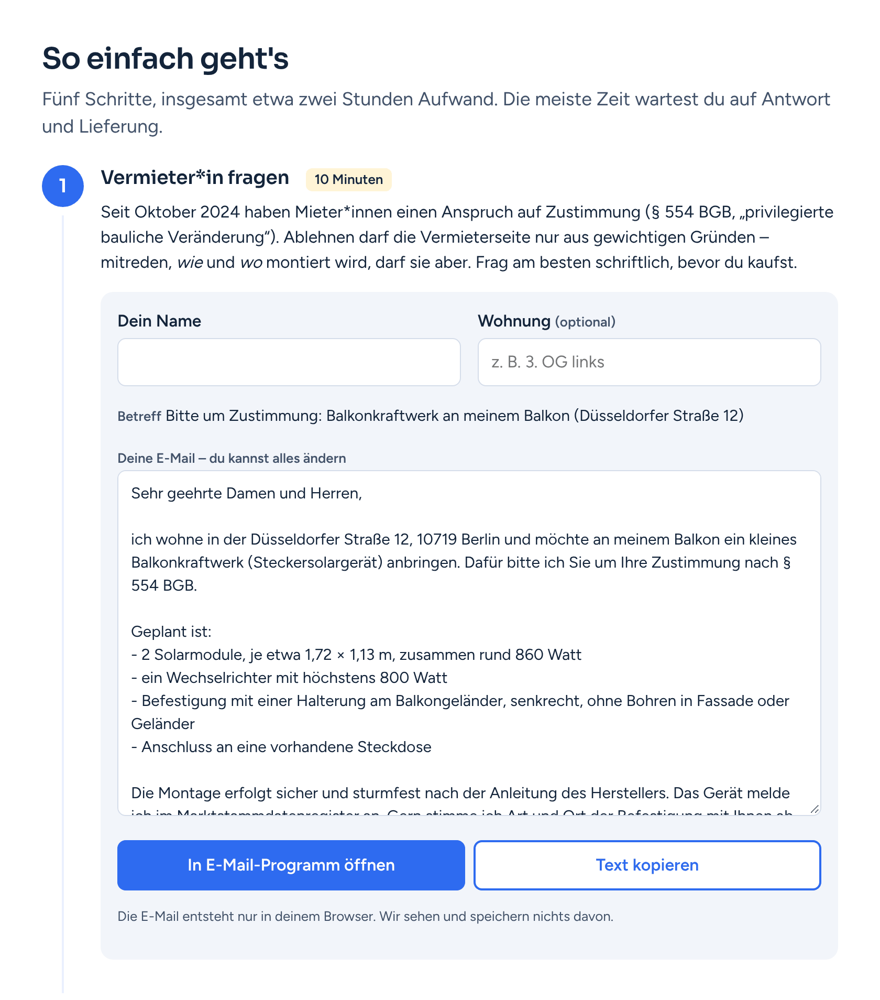

# balki strom

*Balcony solar check for Berlin tenants: find your building in the 3D city model, tap your balcony, get the yearly yield and payback.*

Kostenlose, nicht kommerzielle Website für Mieter\*innen in Berlin: Adresse eingeben, das eigene Haus im 3D-Stadtmodell finden, auf den Balkon tippen. Die Seite rechnet aus, wie viel Strom ein Balkonkraftwerk dort im Jahr erzeugt, wie viel Geld das spart und nach wie vielen Jahren es sich bezahlt macht. Danach zeigt sie die Schritte bis zur Anmeldung.

[](LICENSE)
[](requirements.txt)
[](#datenschutz)
[](#datenschutz)

<p align="center">
  
</p>

## So funktioniert's

1. **Adresse eingeben.** Die Suche läuft im Browser auf einer Liste der amtlichen Hauskoordinaten.
2. **Auf den Balkon tippen.** Das Haus erscheint im fototexturierten 3D-Mesh von Berlin. Ein Tipp auf die Hauswand wählt die Stelle, an der die Module hängen sollen.
3. **Ergebnis lesen.** Ertrag in kWh pro Jahr, Verschattung, Ersparnis, Kostenspanne und Amortisation. Darunter fünf Schritte: Vermieter\*in fragen (mit fertiger E-Mail), Set kaufen, montieren, im Marktstammdatenregister anmelden, Hilfe vor Ort.

<p align="center">
  
  &nbsp;
  
</p>
<p align="center">
  
</p>

## Funktionen

- Eigenes Haus im echten 3D-Stadtmodell (Berlin 3D-Mesh mit Fototextur). Geometrie wird in Zellen, Texturen in Stufen geladen, damit es auch auf schwachen Smartphones läuft.
- Ertrag für genau die angetippte Stelle: 1 oder 2 Module, senkrecht am Geländer oder 30° geneigt.
- Verschattung durch Nachbarhäuser und Bäume über ein ganzes Jahr.
- Eigenverbrauch, Ersparnis, Kostenspanne des Sets und Amortisation. Strompreis, Haushaltsgröße und „tagsüber zu Hause“ sind änderbar.
- Ohne WebGL: grobe Schätzung nach Himmelsrichtung des Balkons.
- E-Mail an die Vermieterseite (Zustimmung nach § 554 BGB) und Werte für die Anmeldung im Marktstammdatenregister, beides im Browser erzeugt.
- Keine Anmeldung, keine Cookies, kein Tracking, keine externen Ressourcen.

## Was gerechnet wird

| Schritt | Wo | Wie |
|---|---|---|
| Wand und Modullage | Server, `balki/rechner.py` | Wandrichtung aus den Mesh-Dreiecken im Umkreis von 2,5 m um den Tipp-Punkt; Außenseite und Geländerkante aus dem Mesh. Die Module hängen außen vor dem Geländer. |
| Horizont | Server, `balki/physik.py` | Aus einer Punktwolke im Umkreis von 220 m (Mesh; außerhalb der Kachel LoD2-Gebäude und bDOM-Bäume), in 2°-Sektoren, getrennt nach Gebäuden und Bäumen. |
| Ertrag | Server, `balki/physik.py` | Stündliche Jahressimulation mit [pvlib](https://pvlib-python.readthedocs.io): Sonnenstand, Erbs, Hay-Davies, ASHRAE-IAM, Faiman-Modultemperatur, PVWatts. Module 430 Wp, Wechselrichter auf 800 W begrenzt. Baumkronen lassen 30 % (Mai–Oktober) bzw. 65 % (November–April) des Lichts durch. |
| Wirtschaftlichkeit | Browser, `web/js/lastgang.js`, `ergebnis.js`, `params.js` | Die 8 760 Stundenwerte werden mit einem minutengenauen, synthetischen Haushaltslastgang verrechnet (Grundlast, Geräte zu typischen Zeiten, Werktag/Wochenende, Urlaub). Daraus folgen Eigenverbrauch, € pro Jahr und Amortisation über 20 Jahre. |

Alle Annahmen (Strompreis 35 ct/kWh, Set-Preise, Haushaltsverbrauch, Preissteigerung, Degradation) stehen in [`web/js/params.js`](web/js/params.js) und werden auf der Seite angezeigt.

### Grenzen

- **Wetter:** synthetisches Referenzjahr für Berlin aus Monatsmitteln. Eine PVGIS-TMY-Datei kann mit `--wetter` eingelesen werden.
- **Genauigkeit:** Der Jahresertrag ist auf etwa ±15 % genau. Er ist eine Schätzung, keine Zusage.
- **Gebiet:** derzeit eine Mesh-Kachel in Berlin-Wilmersdorf (ca. 380 × 370 m). Kacheln in Kreuzberg folgen, sobald das Berlin 3D-Downloadportal wieder erreichbar ist.
- **Preise:** Richtwerte, Stand November 2026, keine Kaufempfehlung.

## Schnellstart

Voraussetzungen: Python 3.10 oder neuer, ein aktueller Browser.

```bash
git clone https://github.com/janhh011/balki_strom.git
cd balki_strom
pip install -r requirements.txt
```

**1. Kachel verarbeiten.** Eine Mesh-Kachel (OBJ, MTL, JPG) aus dem [Berlin 3D-Downloadportal](https://www.businesslocationcenter.de/berlin3d-downloadportal/) laden und nach `data/<kachel-ordner>/` entpacken. Dann:

```bash
python3 pipeline/kachel.py data/3858_58171_-002 --name Wilmersdorf
```

Das erzeugt das Web-Paket unter `web/tiles/<id>/`, trägt die Kachel in `web/tiles/tiles.json` ein und legt den Server-Cache unter `data/work/<id>/` an. LoD2-Gebäude und bDOM für die Umgebung lädt das Skript selbst von gdi.berlin.de nach `data/umgebung/`. Ein zweiter Aufruf nutzt den Cache und dauert Sekunden. Optional: `pip install fast-simplification mapbox-earcut` (vereinfachte Fernansicht, Dreiecke für LoD2-Polygone).

**2. Adressen laden.** Amtliche Hauskoordinaten für alle Kacheln aus `tiles.json`:

```bash
python3 pipeline/adressen.py
```

**3. Server starten.**

```bash
python3 server/app.py
```

Dann <http://127.0.0.1:8000> öffnen.

**Tests:**

```bash
python3 tests/test_rechner.py
```

### Server-Optionen

| Option | Standard | Bedeutung |
|---|---|---|
| `--port` | `8000` | Port |
| `--host` | `127.0.0.1` | Adresse; hinter einem Reverse-Proxy immer `127.0.0.1` |
| `--web` | `web/` | Webroot |
| `--work` | `data/work/` | Server-Caches der Kacheln |
| `--wetter` | – | PVGIS-TMY-Datei statt synthetischem Wetter |
| `--hinter-proxy` | aus | `X-Forwarded-For` von 127.0.0.1 übernehmen (Ratenlimit je Client) |

Umgebungsvariablen: `RECHNEN_PARALLEL` (gleichzeitige Rechnungen, Standard 2), `MAX_VERBINDUNGEN` (64), `LIMIT_ERTRAG_STUNDE` (60 je IP), `LIMIT_LESEN_MINUTE` (600 je IP).

## Weitere Kachel hinzufügen

```bash
# Kachel aus dem Berlin 3D-Downloadportal nach data/<neue-kachel>/ entpacken, dann:
python3 pipeline/kachel.py data/<neue-kachel> --name Kreuzberg
python3 pipeline/adressen.py
# Server neu starten
```

Mehr ist nicht nötig. `kachel.py` aktualisiert die Umgebungsringe benachbarter Kacheln automatisch, sodass der Schatten über den Kachelrand hinaus aus dem Mesh statt aus LoD2 kommt (abschalten mit `--keine-nachbarn`). Weitere Optionen: `--web-neu`, `--umgebung-neu`, `--neu`.

## Projektstruktur

```
balki/          Python-Paket: physik.py (Wetter, Horizont, Ertrag), rechner.py (Tipp-Punkt -> Module -> Ertrag)
pipeline/       kachel.py (Mesh-Kachel -> Web-Paket + Server-Cache), adressen.py (Hauskoordinaten)
server/app.py   Webserver: liefert web/ aus, POST /api/ertrag
web/            Webroot: index.html, css/, fonts/, vendor/three/, js/
  js/           app.js, suche.js, viewer.js, api.js, ergebnis.js, lastgang.js, params.js, schritte.js
tests/          synthetische Testszene für den Rechner
docs/           ARCHITEKTUR.md, STYLEGUIDE.md, bilder/
data/           Rohkacheln, Umgebung, Server-Cache (nicht im Repo)
```

Die übrigen Skripte in `pipeline/` stammen aus einer früheren Version (LoD2-Fassaden, automatische Balkonerkennung) und werden von der aktuellen Seite nicht verwendet.

Architektur und Schnittstellen: [docs/ARCHITEKTUR.md](docs/ARCHITEKTUR.md). Gestaltung: [docs/STYLEGUIDE.md](docs/STYLEGUIDE.md).

### API

Der Server hat einen Endpunkt. Koordinaten in EPSG:25833.

```http
POST /api/ertrag
Content-Type: application/json

{"kachel": "3858_58171", "x": 386001.2, "y": 5817300.4, "z": 52.3, "nx": 0.02, "ny": -0.99,
 "module": 2, "aufstellung": "senkrecht"}
```

Die Antwort enthält Azimut und Himmelsrichtung, Geschoss, Modulecken, `kwh_jahr` (mit Verschattung) und `kwh_jahr_frei` (ohne), 12 Monatswerte, 8 760 Stundenwerte, den Horizont nach Gebäuden und Bäumen sowie Hinweise. Fehler: `400` mit deutschem Fehlertext, `429` Ratenlimit, `503` ausgelastet. Anfragen sind auf 1 KB begrenzt. Vollständiges Format: [docs/ARCHITEKTUR.md](docs/ARCHITEKTUR.md#post-apiertrag-server).

## Daten und Lizenzen

| Quelle | Verwendung | Lizenz |
|---|---|---|
| 3D-Stadtmodell (Mesh), © Senatsverwaltung für Stadtentwicklung, Bauen und Wohnen Berlin, Berlin 3D-Downloadportal | Hausansicht, Horizont | Nicht kommerzielle Nutzung vom Anbieter gestattet. Rohdaten und erzeugte Kacheln sind **nicht** im Repository. |
| Geoportal Berlin (gdi.berlin.de): LoD2-Gebäude, bDOM, amtliche Hauskoordinaten | Schatten außerhalb der Kachel, Adresssuche | Datenlizenz Deutschland – Zero – Version 2.0 |
| [three.js](https://threejs.org) | 3D-Ansicht, selbst gehostet in `web/vendor/three/` | MIT |
| [pvlib](https://github.com/pvlib/pvlib-python) | Ertragsrechnung | BSD-3-Clause |
| Schriften Sora und Figtree, selbst gehostet in `web/fonts/` | Oberfläche | SIL Open Font License 1.1 |

Der Code von balki strom steht unter der [GNU Affero General Public License v3.0](LICENSE). Wer eine geänderte Fassung als Website betreibt, muss deren Quellcode den Nutzer\*innen zugänglich machen.

## Datenschutz

Die Adresssuche läuft vollständig im Browser. Der Server erhält nur die Koordinaten des angetippten Punktes und die gewählte Ausstattung, keine Adresse. Es gibt keine Cookies, kein Tracking und keine Anfragen an Dritte. Der Server speichert keine Anfragen und schreibt keine IP-Adressen ins Log; das Ratenlimit zählt nur im Arbeitsspeicher. Die E-Mail an die Vermieterseite entsteht im Browser. Geänderte Annahmen (Strompreis, Haushalt) merkt sich nur der eigene Browser.

## Mitmachen

Fehlerberichte, Vorschläge und Pull Requests sind willkommen. Besonders hilfreich sind gemessene Jahreserträge echter Balkonkraftwerke in Berlin, um die Rechnung zu prüfen. Ablauf: [CONTRIBUTING.md](CONTRIBUTING.md). Sicherheitslücken bitte nicht öffentlich melden, sondern wie in [SECURITY.md](SECURITY.md) beschrieben.

balki strom ist ein unabhängiges Projekt. Es soll Initiativen wie die Balkonkraftwerk-Aktion des Bezirks Friedrichshain-Kreuzberg unterstützen und ist kein offizielles Angebot des Bezirks.

## Autor

Jan-Hendrik Höltkemeier, M.Sc., TU Berlin · [@janhh011](https://github.com/janhh011)
